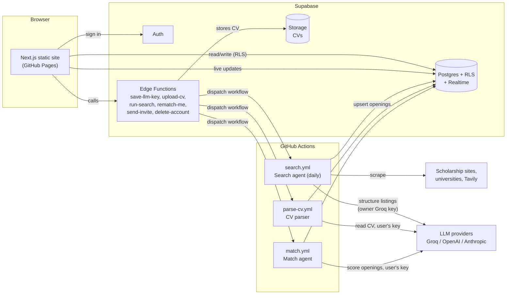

# MSc-PhD Matcher Bot

Find MSc and PhD openings that fit you, see how well your CV matches each one, and track
your applications in one place.

[](LICENSE)

## What it does

1. **Finds openings** every day from scholarship sites, university pages and major
   job boards into one shared pool that every signed-in user can browse.
2. **Matches** your education, experience and interests against each posting's
   requirements and estimates your chances (optional, on your own AI key).
3. **Records** deadlines, requirements, hiring semester, how to reach out, and what the
   application needs.
4. **Shows it** in a fast static website: prioritised by deadline and fit, with notes,
   reordering and a pipeline you can edit. Changes are saved to the database.

## Architecture

Everything runs on free tiers: a static site, scheduled GitHub Actions, and Supabase.
There is no always-on server.



| Layer | Where | Role |
|---|---|---|
| Frontend | `frontend/` | Next.js static export on GitHub Pages: auth, onboarding, dashboard, pipeline, settings |
| Database | `supabase/migrations/` | Postgres schema and row-level security. Openings are shared; matches, notes, CV and keys are private to each user |
| Edge Functions | `supabase/functions/` | Privileged server-side work: validate and encrypt AI keys, accept CV uploads, dispatch workflows, delete accounts |
| Agents | `agents/` | Python: `search/` (scrapers), `cv/` (parser), `matching/` (scorer), `orchestrator.py` records results |
| Automation | `.github/workflows/` | `search.yml` (daily cron), `parse-cv.yml`, `match.yml`, `deploy.yml` |

### Why `supabase/` is in this repo

It is the backend's source code (schema, security policies, functions), not data or
secrets. Keeping it public lets anyone review the security rules and run their own copy.
Credentials live only in GitHub and Supabase secrets.

## Bring your own AI key

Browsing is free. **Personalised matching is optional** and runs on the user's own key
(Groq, OpenAI or Anthropic), so nobody's usage is billed to the project owner.

1. In Settings (or onboarding) a user pastes a key. `save-llm-key` verifies it by asking
   the provider for its model list (no tokens spent), picks a default model, encrypts the
   key with AES-256-GCM and stores it in `user_llm_keys`. The browser can read only the
   key's status, never the key.
2. The CV is read with that key (`parse-cv.yml`), then `match.yml` scores openings. Each
   run is capped (`MATCH_MAX_PER_USER_PER_RUN`, default 40) and skips closed openings,
   wrong degree types and ones already scored.
3. If a provider rejects the key it is marked invalid and scoring stops until the user
   replaces it. If the chosen model is retired the key is marked `model_unavailable` and
   Settings asks the user to pick another.

The owner's `GROQ_API_KEY` is used only by the shared search agent to turn scraped
listings into structured openings.

### Structured output

CV parsing, listing extraction and match scoring ask the provider for output that
matches the Pydantic models in `agents/schemas.py`, then validate it. Refusals,
truncated replies and schema-invalid output are skipped; JSON is never scraped out
of prose. Settings only offers models that support structured output (see
`curateModels` in `supabase/functions/_shared/llm-providers.ts`).

`agents/llm.py` holds the shared retry and error policy; `agents/llm_providers.py` holds
one adapter per provider. To add a provider, subclass `BaseLLMProvider` (or
`OpenAICompatibleProvider` for a Chat Completions API), implement `complete()`, and
register it in `PROVIDERS`. Exposing it in Settings also needs the frontend provider
list, `save-llm-key` validation and the `user_llm_keys` provider constraint.

## Getting started

Requirements: Python 3.13+ with [uv](https://docs.astral.sh/uv/), Node 20+, a
[Supabase](https://supabase.com) project, and the [Supabase CLI](https://supabase.com/docs/guides/cli).

### Backend and agents

```bash
uv sync
cp .env.example .env   # fill in Supabase, Groq, Tavily keys and COOKIE_ENCRYPTION_KEY
```

Apply the migrations in `supabase/migrations/` in order (`supabase db push` or the
dashboard SQL editor), then run an agent:

```bash
uv run --env-file .env python -m agents.search.agent
uv run --env-file .env python -m agents.matching.agent --opp-ids all
```

### Frontend

```bash
cd frontend
npm install
cp .env.local.example .env.local   # NEXT_PUBLIC_SUPABASE_URL / ANON_KEY
npm run dev
```

### Edge Functions

```bash
supabase functions deploy send-invite upload-cv run-search rematch-me save-llm-key delete-account
supabase secrets set GITHUB_PAT=<fine-grained PAT, Actions: write> \
  GITHUB_REPO=<owner>/<repo> SITE_URL=<pages url> ALLOWED_ORIGIN=<pages url> \
  COOKIE_ENCRYPTION_KEY=<same key as .env>
```

Generate the encryption key with `openssl rand -base64 32`.

### Deploying the site

`deploy.yml` needs repo secrets `NEXT_PUBLIC_SUPABASE_URL` and
`NEXT_PUBLIC_SUPABASE_ANON_KEY`, plus Settings → Pages → Source: **GitHub Actions**. The
agents also need `SUPABASE_URL`, `SUPABASE_SERVICE_ROLE_KEY`, `GROQ_API_KEY`,
`TAVILY_API_KEY` and `COOKIE_ENCRYPTION_KEY` as Actions secrets.

## Development

```bash
uv run --extra dev pytest
uv run --extra dev ruff check .
node --experimental-strip-types --test supabase/functions/_shared/llm-providers.test.mjs  # Node 22.6+
cd frontend && npm run lint
```

## Contributing

See [CONTRIBUTING.md](CONTRIBUTING.md). Report vulnerabilities privately as described in
[SECURITY.md](SECURITY.md).

## Status

Phases 1–3 are done: schema and RLS, email/password auth with open signup, CV parser,
search agent covering the Phase 1–2 sources, match agent, and the static frontend
(auth, onboarding, dashboard with Realtime and detail drawer, pipeline, settings).
LinkedIn scraping and research-lab discovery have been removed.

## License

[MIT](LICENSE)
